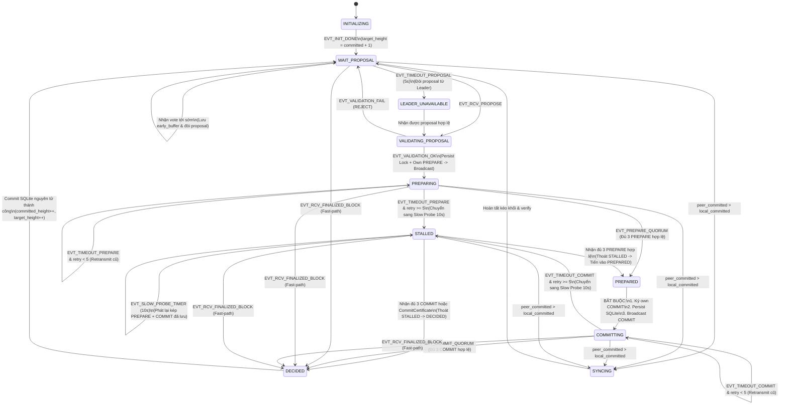

# Đặc tả Máy Trạng thái Đồng thuận (Consensus State Machine Specification)

- **Mã tài liệu:** `TV2-W1-STATE-MACHINE`
- **Người phụ trách:** TV2 · Nguyễn Minh Đức (@DucNguyen)
- **Người thẩm định (Reviewers):** TV1 (Core), TV3 (Network/Storage), TV4 (Frontend/Evaluation)
- **Tài liệu nền tảng:** [docs/protocol.md](protocol.md)
- **Phiên bản:** 1.2 (Cập nhật theo Review TV4 vòng 2)
- **Tình trạng:** Đã đồng bộ luồng thoát STALLED, cơ chế Slow Probe và lưu bằng chứng Equivocation

---

## 1. Tổng quan Máy Trạng thái (State Machine Overview)

Trong mỗi validator node, **Consensus State Machine (CSM)** là thành phần điều phối vòng đời đồng thuận tại từng khối (`height`). CSM nhận các sự kiện đầu vào (thông điệp từ mạng, tín hiệu hết hạn bộ đếm thời gian, kết quả thẩm định từ module Core), kiểm tra các điều kiện an toàn (Guards) và thực hiện chuyển dịch trạng thái (Transitions) một cách tất định.

### Bất biến thiết kế (Design Invariants)
1. **Tính tất định (Determinism):** Với cùng một chuỗi sự kiện và dữ liệu đầu vào, CSM tại các node trung thực phải chuyển dịch qua các trạng thái tương đương.
2. **Quy tắc Persist-Before-Send bắt buộc (Tiêu chí T22, T29):**
   - Khóa bền vững (`consensus_locks`) và Phiếu bầu của chính mình (`consensus_votes`) phải được ghi nguyên tử vào SQLite **TRƯỚC KHI** broadcast thông điệp `PREPARE` ra mạng.
   - Khi khởi động lại (Restart), CSM nạp lại cả khóa và phiếu bầu cũ để kiên quyết từ chối ký đề xuất khác.
3. **Phân định rõ ràng Chiều cao Khối:**
   - `committed_height`: Đỉnh chuỗi đã chốt trong cơ sở dữ liệu SQLite cục bộ.
   - `target_height = committed_height + 1`: Chiều cao khối đang xử lý đồng thuận.
4. **Bảo tồn Bằng chứng Vi phạm (Tiêu chí T17):**
   - Mọi hành vi double-signing (Equivocation) đều phải được thu thập đầy đủ cả hai phiếu đối lập kèm chữ ký và lưu trữ bền vững.

---

## 2. Định nghĩa các Trạng thái (State Definitions)

Tại một vòng đồng thuận cho `target_height`, CSM của một Validator trải qua các trạng thái sau:

| Mã Trạng thái | Tên Trạng thái | Ý nghĩa và Hành vi |
|---|---|---|
| `S0` | `INITIALIZING` | Khởi động, đọc Genesis, nạp public keys, mở database SQLite, đọc `committed_height = max_height_db`, đặt `target_height = committed_height + 1`. Nạp lại `locked_block_hash` nếu có từ trước |
| `S1` | `WAIT_PROPOSAL` | Sẵn sàng cho `target_height`, khởi động `PROPOSAL_TIMEOUT`, chờ nhận `PROPOSE` từ Leader hoặc xử lý phiếu trong buffer |
| `S2` | `VALIDATING_PROPOSAL` | Nhận được khối từ Leader, tạm dừng timer, chuyển giao khối cho module Core để kiểm tra tính hợp lệ |
| `S3` | `PREPARING` | Khối hợp lệ; **đã lưu nguyên tử Lock + Own PREPARE vào SQLite** và phát `PREPARE`; bật `PREPARE_TIMEOUT`; đang gom phiếu `PREPARE` |
| `S4` | `PREPARED` | Đã thu thập đủ $\ge 3$ phiếu `PREPARE` hợp lệ $\Rightarrow$ Tạo `PreparedCertificate`. Tự động ký, lưu và phát `COMMIT` |
| `S5` | `COMMITTING` | Đã lưu Own COMMIT vào SQLite và phát `COMMIT`; bật `COMMIT_TIMEOUT`; đang gom phiếu `COMMIT` |
| `S6` | `DECIDED` (COMMITTED) | Đã thu thập đủ $\ge 3$ phiếu `COMMIT` hợp lệ $\Rightarrow$ Tạo `CommitCertificate`. Thực hiện commit nguyên tử vào SQLite, cập nhật `committed_height = target_height`, xóa lock cũ, tăng `target_height` |
| `E1` | `LEADER_UNAVAILABLE` | Hết `PROPOSAL_TIMEOUT` mà không nhận được đề xuất hợp lệ. Node gửi yêu cầu kéo proposal từ Leader/Peers và tiếp tục chờ |
| `E2` | `STALLED` | Hết số lần Fast Retry ($K=5$) ở pha PREPARE hoặc COMMIT mà chưa đủ Quorum. Dừng phát retry dồn dập, chuyển sang cơ chế **Slow Probe** (phát lại chậm 10s) và lắng nghe thụ động |
| `R0` | `SYNCING` | Phát hiện `peer_committed_height > local_committed_height`. Tạm dừng consensus để đồng bộ khối và certificate thiếu từ peer |

---

## 3. Danh mục Sự kiện Đầu vào (Input Events)

- `EVT_INIT_DONE`: Khởi tạo và đọc database hoàn tất.
- `EVT_RCV_PROPOSE(block, sig)`: Nhận thông điệp `PROPOSE` từ mạng.
- `EVT_VALIDATION_OK`: Module Core xác nhận dữ liệu khối, chữ ký giao dịch, `prev_hash == tip_hash` và `state_hash` hoàn toàn chính xác.
- `EVT_VALIDATION_FAIL(reason)`: Khối đề xuất không hợp lệ (sai chữ ký, sai số dư, sai hash).
- `EVT_RCV_PREPARE(vote)`: Nhận một phiếu bầu `PREPARE` từ một peer.
- `EVT_PREPARE_QUORUM(prepared_cert)`: Bộ gom phiếu `PrepareVoteSet` đạt đủ 3 phiếu hợp lệ khớp toàn bộ Context.
- `EVT_RCV_COMMIT(vote)`: Nhận một phiếu bầu `COMMIT` từ một peer.
- `EVT_COMMIT_QUORUM(commit_cert)`: Bộ gom phiếu `CommitVoteSet` đạt đủ 3 phiếu hợp lệ khớp toàn bộ Context.
- `EVT_TIMEOUT_PROPOSAL`: Hết hạn bộ đếm `PROPOSAL_TIMEOUT` (5.0s).
- `EVT_TIMEOUT_PREPARE`: Hết hạn bộ đếm `PREPARE_TIMEOUT` (2.0s).
- `EVT_TIMEOUT_COMMIT`: Hết hạn bộ đếm `COMMIT_TIMEOUT` (2.0s).
- `EVT_SLOW_PROBE_TIMER`: Hết hạn bộ đếm `STALLED_PROBE_TIMER` (10s ± 2s jitter).
- `EVT_RETRY_EXCEEDED`: Số lần thử lại nhanh vượt quá ngưỡng $K=5$.
- `EVT_PEER_AHEAD(peer_committed_height)`: Phát hiện peer có `peer_committed_height > local_committed_height`.
- `EVT_RCV_COMMIT_CERT(cert)`: Nhận được `CommitCertificate` hợp lệ từ peer cho khối đang khóa.
- `EVT_RCV_FINALIZED_BLOCK(finalized)`: Nhận thông điệp `FinalizedBlock` (Proposal + CommitCertificate) qua `POST /peer/finalized` phục vụ đường dẫn nhanh Fast-path.

---

## 4. Bảng Chuyển dịch Trạng thái Chi tiết (State Transition Table)

| Trạng thái hiện tại | Sự kiện kích hoạt | Điều kiện kiểm tra (Guard) | Hành động thực thi (Action) | Trạng thái tiếp theo |
|---|---|---|---|---|
| `INITIALIZING` | `EVT_INIT_DONE` | Database mở thành công, Genesis hợp lệ | Đọc `committed_height`; đặt `target_height = committed_height + 1`; đọc `locked_block_hash` từ SQLite nếu có | `WAIT_PROPOSAL` |
| `WAIT_PROPOSAL` | `EVT_RCV_PROPOSE` | Sender là `node1`, `block.height == target_height`, `block.prev_hash == tip_hash`, chưa bị khóa giá trị khác | Hủy `PROPOSAL_TIMEOUT`; Đưa khối vào hàng đợi thẩm định | `VALIDATING_PROPOSAL` |
| `WAIT_PROPOSAL` | `EVT_RCV_PREPARE` hoặc `EVT_RCV_COMMIT` | `vote.height == target_height` nhưng chưa có Proposal | Lưu vào `early_votes_buffer` (tối đa 50); Gửi request `GET /consensus/proposal?height=target_height` tới Leader/Peers (Tiêu chí T15) | `WAIT_PROPOSAL` |
| `WAIT_PROPOSAL` | `EVT_TIMEOUT_PROPOSAL` | Chưa nhận được proposal nào | Gửi request đòi proposal từ Leader; ghi log cảnh báo `LEADER_UNAVAILABLE`; Reset timer | `LEADER_UNAVAILABLE` |
| `LEADER_UNAVAILABLE`| `EVT_RCV_PROPOSE` | Nhận được proposal hợp lệ từ Leader | Hủy timer; Bắt đầu thẩm định khối | `VALIDATING_PROPOSAL` |
| `VALIDATING_PROPOSAL`| `EVT_VALIDATION_OK` | Khối hợp lệ, không xung đột Lock | **Persist-Before-Send bắt buộc (T22, T29):**<br>1. Lưu nguyên tử vào SQLite: `consensus_locks` (khóa `block_hash`) và `consensus_votes` (phiếu PREPARE)<br>2. Cập nhật `locked_block_hash = block_hash`<br>3. Khởi tạo `PrepareVoteSet` và `CommitVoteSet` cho `block_hash`<br>4. Broadcast `PREPARE`<br>5. Đưa own vote vào `PrepareVoteSet`<br>6. Xả `early_votes_buffer` cho pha PREPARE<br>7. Bật `PREPARE_TIMEOUT` | `PREPARING` |
| `VALIDATING_PROPOSAL`| `EVT_VALIDATION_FAIL` | Phát hiện lỗi nghiệp vụ / chữ ký giả | Ghi log vi phạm `REJECT`; Quay lại chờ đề xuất khác hoặc timeout | `WAIT_PROPOSAL` |
| `PREPARING` | `EVT_RCV_PREPARE` | Khớp toàn bộ Context (T14), chữ ký hợp lệ, sender hợp lệ | Gọi `add_vote(vote)`: Kiểm tra Equivocation độc lập thứ tự (T17), tích lũy Quorum | `PREPARING` |
| `PREPARING` | `EVT_PREPARE_QUORUM` | `PrepareVoteSet.has_quorum() == True` | 1. Gom 3 chữ ký tạo `PreparedCertificate`<br>2. Hủy `PREPARE_TIMEOUT`<br>3. Xả `early_votes_buffer` cho pha COMMIT | `PREPARED` |
| `PREPARING` | `EVT_TIMEOUT_PREPARE` | Chưa đủ 3 phiếu, `retry_count < 5` | Tăng `retry_count += 1`; Đọc vote cũ từ SQLite và broadcast lại | `PREPARING` |
| `PREPARING` | `EVT_TIMEOUT_PREPARE` | Chưa đủ 3 phiếu, `retry_count >= 5` | Dừng fast retry; Bật `STALLED_PROBE_TIMER` (10s); Chuyển sang cơ chế Slow Probe | `STALLED` |
| `PREPARED` | Tự động kích hoạt | Sở hữu `PreparedCertificate` hợp lệ | **Quy trình ký và phát COMMIT chuẩn:**<br>1. Ký vote `COMMIT`<br>2. **Persist-Before-Send:** Lưu vote `COMMIT` vào SQLite<br>3. Broadcast `COMMIT`<br>4. Thêm vote của mình vào `CommitVoteSet`<br>5. Bật `COMMIT_TIMEOUT` | `COMMITTING` |
| `COMMITTING` | `EVT_RCV_COMMIT` | Khớp toàn bộ Context (T14), chữ ký hợp lệ | Gọi `add_vote(vote)`: Kiểm tra Equivocation, tích lũy Quorum | `COMMITTING` |
| `COMMITTING` | `EVT_COMMIT_QUORUM` | `CommitVoteSet.has_quorum() == True` | 1. Gom 3 chữ ký tạo `CommitCertificate`<br>2. Hủy `COMMIT_TIMEOUT` | `DECIDED` |
| `COMMITTING` | `EVT_TIMEOUT_COMMIT` | Chưa đủ 3 phiếu, `retry_count < 5` | Tăng `retry_count += 1`; Đọc vote cũ từ SQLite và broadcast lại | `COMMITTING` |
| `COMMITTING` | `EVT_TIMEOUT_COMMIT` | Chưa đủ 3 phiếu, `retry_count >= 5` | Dừng fast retry; Bật `STALLED_PROBE_TIMER` (10s); Chuyển sang cơ chế Slow Probe | `STALLED` |
| **`STALLED`** | `EVT_PREPARE_QUORUM` | Đang kẹt ở PREPARE, nhận đủ 3 phiếu PREPARE hợp lệ | Gom `PreparedCertificate`; Hủy timer probe; **Chuyển sang `PREPARED`** để ký, lưu và phát COMMIT | **`PREPARED`** |
| **`STALLED`** | `EVT_COMMIT_QUORUM` hoặc `EVT_RCV_COMMIT_CERT` | Đang kẹt ở COMMIT, nhận đủ 3 COMMIT hoặc nhận Certificate từ peer | Gom/xác thực `CommitCertificate`; Hủy timer probe; **Chuyển sang `DECIDED`** | **`DECIDED`** |
| **`STALLED`** | `EVT_SLOW_PROBE_TIMER` | Hết 10s thăm dò, mạng chưa tiến triển | **Phát lại kép (Dual-vote):** Broadcast lại own PREPARE và own COMMIT nếu đã lưu cả hai (để cứu peer kẹt pha trước theo `module-interfaces.md §4`); Hoặc gửi `GET /consensus/status` tới peers; Reset probe timer | `STALLED` |
| *Trạng thái chưa chốt* (`WAIT_PROPOSAL`, `PREPARING`, `COMMITTING`, `STALLED`) | `EVT_RCV_FINALIZED_BLOCK` | `finalized.height == target_height`, proposal và CommitCertificate hợp lệ | **Fast-path:** Xác thực proposal và chữ ký $\ge 3$ validator trong certificate, thực thi block kiểm tra `state_hash`. Commit SQLite nguyên tử không cần trải qua vote cục bộ | `DECIDED` |
| `DECIDED` | Hoàn tất commit | Transaction SQLite thành công | 1. Ghi Block + Certificate vào SQLite<br>2. Cập nhật State accounts<br>3. Dọn Mempool<br>4. Xóa Lock của `target_height`<br>5. Cập nhật `committed_height = target_height`<br>6. Đặt `target_height = committed_height + 1`<br>7. Reset VoteSets và buffer | `WAIT_PROPOSAL` |
| *Bất kỳ trạng thái*| `EVT_PEER_AHEAD` | `peer_committed_height > local_committed_height` | Lưu trạng thái hiện tại, chuyển sang chế độ kéo dữ liệu khối và certificate thiếu | `SYNCING` |
| `SYNCING` | Hoàn tất đồng bộ | Đã tải và verify đủ chuỗi đến đỉnh mới | Cập nhật `committed_height = tip_height`; `target_height = committed_height + 1`; Trở lại chờ proposal | `WAIT_PROPOSAL` |

---

## 5. Sơ đồ Chuyển dịch Trạng thái (Mermaid State Machine Diagram)



---

## 6. Thuật toán VoteSet và Lưu Trữ Bằng Chứng Equivocation (Tiêu chí T14, T17)

Để đảm bảo an toàn tuyệt đối khi thu thập phiếu từ mạng, lớp `VoteSet` tại mỗi pha (`PrepareVoteSet`, `CommitVoteSet`) phải được khởi tạo với Context kỳ vọng và hash mục tiêu, đồng thời tách biệt giữa **Tập phiếu tính Quorum**, **Bảng chứng cứ phiếu đã quan sát** và **Kho lưu trữ bằng chứng vi phạm Byzantine**:

### 6.1 Cấu trúc Lưu trữ trong Bộ nhớ (Memory Structure)
```python
class VoteSet:
    def __init__(
        self,
        protocol_version: int,
        chain_id: str,
        target_height: int,
        target_view: int,
        target_phase: str,
        expected_block_hash: str,
        authorized_validators: list[str]
    ):
        self.protocol_version = protocol_version
        self.chain_id = chain_id
        self.target_height = target_height
        self.target_view = target_view
        self.target_phase = target_phase
        self.expected_block_hash = expected_block_hash
        self.authorized_validators = set(authorized_validators)
        
        # Bảng chứng cứ đã quan sát: sender_id -> Vote (Lưu phiếu đầu tiên hợp lệ nhận được)
        self.seen_votes: dict[str, Vote] = {}
        
        # Tập phiếu hợp lệ phục vụ tính Quorum: sender_id -> Vote (chỉ chứa phiếu khớp expected_block_hash)
        self.quorum_votes: dict[str, Vote] = {}
        
        # Kho lưu trữ bằng chứng Byzantine: sender_id -> (Vote_A, Vote_B)
        self.equivocation_evidence: dict[str, tuple[Vote, Vote]] = {}
```

### 6.2 Thuật toán Thêm Phiếu và Bắt Equivocation Độc Lập Thứ Tự (T14, T17)
```python
def add_vote(self, vote: Vote, crypto_verifier, storage_repo=None) -> bool:
    # 1. Thẩm định toàn diện Context (Tiêu chí T14)
    if (vote.protocol_version != self.protocol_version or
        vote.chain_id != self.chain_id or
        vote.height != self.target_height or
        vote.view != self.target_view or
        vote.phase != self.target_phase):
        logger.warning(f"Từ chối vote sai Context: {vote}")
        return False

    # 2. Kiểm tra danh tính validator được cấp quyền
    if vote.sender_id not in self.authorized_validators:
        logger.warning(f"Từ chối vote từ validator không cấp quyền: {vote.sender_id}")
        return False

    # 3. Xác thực chữ ký Ed25519 trên byte chuẩn hóa (bỏ trường signature)
    if not crypto_verifier.verify(vote.sender_id, vote):
        logger.warning(f"Từ chối vote có chữ ký không hợp lệ từ: {vote.sender_id}")
        return False

    # 4. Kiểm tra Equivocation độc lập với thứ tự nhận phiếu (Tiêu chí T17)
    if vote.sender_id in self.seen_votes:
        existing_vote = self.seen_votes[vote.sender_id]
        if vote.block_hash == existing_vote.block_hash:
            # Idempotent: Phiếu trùng lặp hợp lệ do retry mạng
            return True
        else:
            # PHÁT HIỆN BYZANTINE EQUIVOCATION: Sender đã ký 2 giá trị khác nhau!
            # Bắt buộc lưu trữ cả 2 phiếu làm bằng chứng đối chất không thể chối cãi
            evidence = (existing_vote, vote)
            self.equivocation_evidence[vote.sender_id] = evidence
            
            logger.error(
                f"PHÁT HIỆN BYZANTINE EQUIVOCATION từ {vote.sender_id}! "
                f"Vote 1 Hash: {existing_vote.block_hash}, Vote 2 Hash: {vote.block_hash}"
            )
            
            # Lưu bền vững bằng chứng vào SQLite thông qua storage interface (TV3)
            if storage_repo:
                storage_repo.save_equivocation_evidence(
                    height=self.target_height,
                    phase=self.target_phase,
                    sender_id=vote.sender_id,
                    vote_a=existing_vote,
                    vote_b=vote
                )
            
            # Loại bỏ validator gian lận khỏi Quorum (nếu phiếu trước đã lỡ đưa vào)
            self.quorum_votes.pop(vote.sender_id, None)
            return False

    # Ghi nhận vào bảng phiếu đã quan sát
    self.seen_votes[vote.sender_id] = vote

    # 5. Tích lũy vào Quorum nếu khớp block_hash kỳ vọng
    if vote.block_hash == self.expected_block_hash:
        self.quorum_votes[vote.sender_id] = vote
        return True

    return False

def has_quorum(self) -> bool:
    # Quorum đạt khi có đủ >= 3 chữ ký từ 3 validator khác nhau khớp block_hash kỳ vọng
    return len(self.quorum_votes) >= 3

def get_equivocation_evidence(self) -> dict[str, tuple[Vote, Vote]]:
    """Trả về bằng chứng gian lận phục vụ xuất báo cáo và đối chất."""
    return self.equivocation_evidence
```

---

## 7. Khung Cài đặt Tham khảo cho Tuần 2 (W2 Python Interface Skeleton)

Lớp `ConsensusEngine` trong `src/consensus/` được bổ sung timer thăm dò `STALLED` và tích hợp lưu trữ bằng chứng Equivocation:

```python
from enum import Enum
from typing import Optional, List, Dict, Tuple

class ConsensusState(str, Enum):
    INITIALIZING = "INITIALIZING"
    WAIT_PROPOSAL = "WAIT_PROPOSAL"
    VALIDATING_PROPOSAL = "VALIDATING_PROPOSAL"
    PREPARING = "PREPARING"
    PREPARED = "PREPARED"
    COMMITTING = "COMMITTING"
    DECIDED = "DECIDED"
    LEADER_UNAVAILABLE = "LEADER_UNAVAILABLE"
    STALLED = "STALLED"
    SYNCING = "SYNCING"

class ConsensusEngine:
    def __init__(self, node_id: str, private_key: str, storage_repo, network_client, config):
        self.node_id = node_id
        self.private_key = private_key
        self.storage = storage_repo
        self.network = network_client
        self.config = config
        
        # Chiều cao khối
        self.committed_height = self.storage.get_max_height()
        self.target_height = self.committed_height + 1
        
        self.state = ConsensusState.INITIALIZING
        self.locked_block_hash: Optional[str] = self.storage.get_lock(self.target_height)
        
        # Bộ gom phiếu (Được khởi tạo lại sau khi xác định block_hash hợp lệ)
        self.prepare_votes: Optional[VoteSet] = None
        self.commit_votes: Optional[VoteSet] = None
        self.early_votes_buffer: List[Vote] = []
        self.retry_count = 0

    def init_round_for_proposal(self, block_hash: str) -> None:
        """Khởi tạo VoteSet đầy đủ context sau khi block đề xuất được xác nhận hợp lệ."""
        self.prepare_votes = VoteSet(
            protocol_version=self.config.PROTOCOL_VERSION,
            chain_id=self.config.CHAIN_ID,
            target_height=self.target_height,
            target_view=0,
            target_phase="PREPARE",
            expected_block_hash=block_hash,
            authorized_validators=self.config.VALIDATORS
        )
        self.commit_votes = VoteSet(
            protocol_version=self.config.PROTOCOL_VERSION,
            chain_id=self.config.CHAIN_ID,
            target_height=self.target_height,
            target_view=0,
            target_phase="COMMIT",
            expected_block_hash=block_hash,
            authorized_validators=self.config.VALIDATORS
        )

    def on_receive_proposal(self, block: Block, proposal_sig: str) -> None:
        """Xử lý đề xuất từ Leader."""
        ...

    def on_receive_vote(self, vote: Vote) -> None:
        """Xử lý phiếu PREPARE hoặc COMMIT từ peer (có xử lý buffer và equivocation)."""
        ...

    def on_timeout(self, timer_type: str) -> None:
        """Xử lý hết hạn timer, fast retry và Slow Probe khi ở STALLED."""
        ...

    def on_slow_probe_trigger(self) -> None:
        """Định kỳ phát lại phiếu bầu đã lưu (10s) khi ở STALLED.
        Nếu đã lưu cả PREPARE và COMMIT, phát lại CẢ HAI phiếu để cứu peer kẹt pha trước."""
        if self.state == ConsensusState.STALLED:
            own_prepare = self.storage.get_own_signed_vote(self.target_height, "PREPARE")
            if own_prepare:
                self.network.broadcast_vote(own_prepare)
            own_commit = self.storage.get_own_signed_vote(self.target_height, "COMMIT")
            if own_commit:
                self.network.broadcast_vote(own_commit)

    def on_receive_finalized(self, finalized: FinalizedBlock) -> None:
        """Xử lý đường dẫn nhanh Fast-Path khi nhận FinalizedBlock hợp lệ từ peer."""
        ...

    def advance_height(self) -> None:
        """Chuyển sang target_height tiếp theo sau khi commit thành công."""
        self.committed_height = self.target_height
        self.target_height = self.committed_height + 1
        self.locked_block_hash = None
        self.prepare_votes = None
        self.commit_votes = None
        self.retry_count = 0
        self.state = ConsensusState.WAIT_PROPOSAL
```

---

## 8. Kế hoạch Thẩm định (Review & Verification)

- **TV1 thẩm định:** Kiểm tra tính tương thích giữa bước `VALIDATING_PROPOSAL` với hàm `execute_block()` và cách tính `state_hash` trong Core.
- **TV3 thẩm định:** Xác nhận các điểm `Persist-Before-Send` trong State Machine; cài đặt endpoint kéo proposal thiếu `GET /consensus/proposal`; cài đặt bảng SQLite `consensus_equivocations` lưu cặp bằng chứng `(vote_a, vote_b)`.
- **TV4 thẩm định:** Thống nhất các trạng thái hiển thị (`PREPARING`, `COMMITTING`, `LEADER_UNAVAILABLE`, `STALLED`, `SYNCING`) để hiển thị màu sắc và badge tương ứng trên UI Dashboard.
