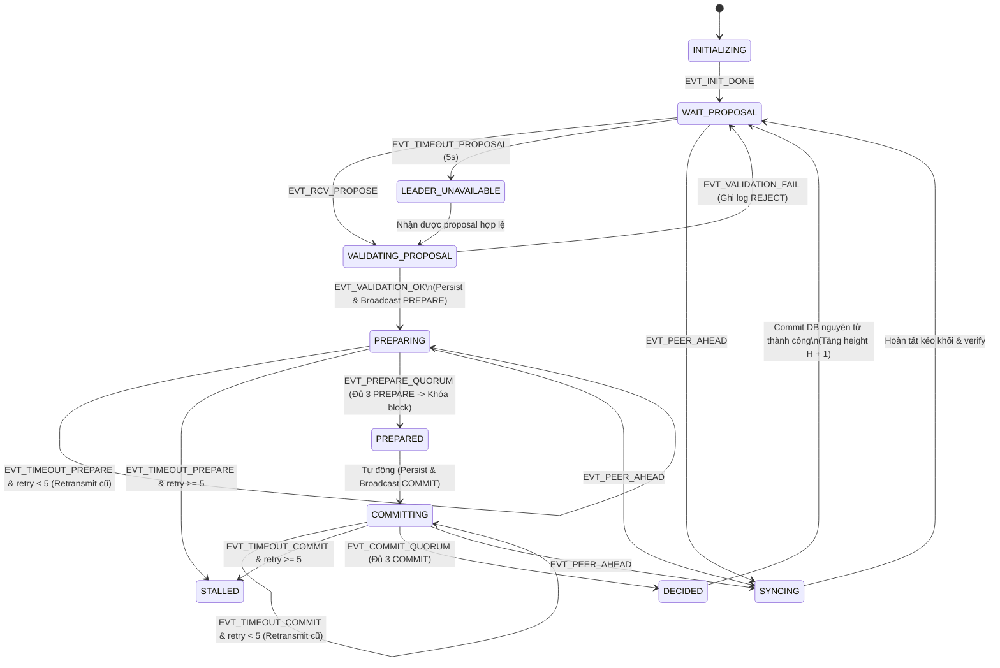

# Đặc tả Máy Trạng thái Đồng thuận (Consensus State Machine Specification)

- **Mã tài liệu:** `TV2-W1-STATE-MACHINE`
- **Người phụ trách:** TV2 · Nguyễn Minh Đức (@DucNguyen)
- **Người thẩm định (Reviewers):** TV1 (Core), TV3 (Network/Storage), TV4 (Frontend/Evaluation)
- **Tài liệu nền tảng:** [docs/protocol.md](protocol.md)
- **Phiên bản:** 1.0 (Draft Tuần 1)
- **Tình trạng:** Chờ review nội bộ nhóm

---

## 1. Tổng quan Máy Trạng thái (State Machine Overview)

Trong mỗi validator node, **Consensus State Machine (CSM)** là thành phần điều phối vòng đời đồng thuận tại từng khối (`height`). CSM nhận các sự kiện đầu vào (thông điệp từ mạng, tín hiệu hết hạn bộ đếm thời gian, kết quả thẩm định từ module Core), kiểm tra các điều kiện an toàn (Guards) và thực hiện chuyển dịch trạng thái (Transitions) một cách tất định.

### Bất biến thiết kế (Design Invariant)
1. **Tính tất định (Determinism):** Với cùng một chuỗi sự kiện và dữ liệu đầu vào, CSM tại các node trung thực phải chuyển dịch qua các trạng thái tương đương.
2. **Nguyên tắc bền vững trước khi chuyển trạng thái:** Các biến trạng thái cốt lõi (Khóa, phiếu bầu, certificate) phải được lưu xuống SQLite trước khi trạng thái bộ nhớ chuyển dịch và trước khi broadcast thông điệp ra mạng (*Persist-Before-Send*).

---

## 2. Định nghĩa các Trạng thái (State Definitions)

Tại một block `height` nhất định, CSM của một Validator trải qua các trạng thái sau:

| Mã Trạng thái | Tên Trạng thái | Ý nghĩa và Hành vi |
|---|---|---|
| `S0` | `INITIALIZING` | Khởi động, đọc Genesis, nạp public keys, mở database SQLite, phục hồi trạng thái height và lock trước đó |
| `S1` | `WAIT_PROPOSAL` | Đã sẵn sàng ở `height = H`, khởi động `PROPOSAL_TIMEOUT`, chờ nhận thông điệp `PROPOSE` từ Leader |
| `S2` | `VALIDATING_PROPOSAL` | Nhận được khối từ Leader, tạm dừng timer, chuyển giao khối cho module Core để kiểm tra tính hợp lệ |
| `S3` | `PREPARING` | Khối hợp lệ; node đã lưu và phát phiếu `PREPARE`; khởi động `PREPARE_TIMEOUT`; đang gom phiếu `PREPARE` |
| `S4` | `PREPARED` | Đã thu thập đủ $\ge 3$ phiếu `PREPARE` hợp lệ $\Rightarrow$ Tạo `PreparedCertificate`, thiết lập **Durable Lock** vào `block_hash` này |
| `S5` | `COMMITTING` | Node đã lưu và phát phiếu `COMMIT`; khởi động `COMMIT_TIMEOUT`; đang gom phiếu `COMMIT` |
| `S6` | `DECIDED` (COMMITTED) | Đã thu thập đủ $\ge 3$ phiếu `COMMIT` hợp lệ $\Rightarrow$ Tạo `CommitCertificate`. Thực hiện commit nguyên tử vào SQLite, tăng height $H \leftarrow H+1$ |
| `E1` | `LEADER_UNAVAILABLE` | Hết `PROPOSAL_TIMEOUT` mà không nhận được đề xuất hợp lệ từ Leader. Node chờ đợi và cảnh báo |
| `E2` | `STALLED` | Hết số lần Retry tối đa ($K=5$) ở pha PREPARE hoặc COMMIT mà không đạt Quorum. Dừng an toàn để bảo vệ tính nhất quán |
| `R0` | `SYNCING` | Node nhận thấy peer khác có `height > current_height`, tạm dừng consensus để đồng bộ khối và certificate thiếu |

---

## 3. Danh mục Sự kiện Đầu vào (Input Events)

Các sự kiện có thể kích hoạt chuyển dịch trạng thái trong CSM:

- `EVT_INIT_DONE`: Quá trình khởi tạo và phục hồi dữ liệu hoàn tất.
- `EVT_RCV_PROPOSE(block, sig)`: Nhận gói tin `PROPOSE` từ mạng.
- `EVT_VALIDATION_OK`: Module Core xác nhận dữ liệu khối, chữ ký giao dịch, `prev_hash` và `state_hash` hoàn toàn chính xác.
- `EVT_VALIDATION_FAIL(reason)`: Khối đề xuất không hợp lệ (sai chữ ký, sai số dư, sai hash).
- `EVT_RCV_PREPARE(vote)`: Nhận một phiếu bầu `PREPARE` từ một peer.
- `EVT_PREPARE_QUORUM(prepared_cert)`: Bộ gom phiếu `PrepareVoteSet` đạt đủ 3 phiếu hợp lệ từ 3 validator khác nhau.
- `EVT_RCV_COMMIT(vote)`: Nhận một phiếu bầu `COMMIT` từ một peer.
- `EVT_COMMIT_QUORUM(commit_cert)`: Bộ gom phiếu `CommitVoteSet` đạt đủ 3 phiếu hợp lệ từ 3 validator khác nhau.
- `EVT_TIMEOUT_PROPOSAL`: Hết hạn bộ đếm `PROPOSAL_TIMEOUT` (5.0s).
- `EVT_TIMEOUT_PREPARE`: Hết hạn bộ đếm `PREPARE_TIMEOUT` (2.0s).
- `EVT_TIMEOUT_COMMIT`: Hết hạn bộ đếm `COMMIT_TIMEOUT` (2.0s).
- `EVT_RETRY_EXCEEDED`: Số lần thử lại (retry count) vượt quá ngưỡng $K=5$.
- `EVT_PEER_AHEAD(peer_height)`: Phát hiện mạng đã tiến tới height cao hơn.

---

## 4. Bảng Chuyển dịch Trạng thái Chi tiết (State Transition Table)

| Trạng thái hiện tại | Sự kiện kích hoạt | Điều kiện kiểm tra (Guard) | Hành động thực thi (Action) | Trạng thái tiếp theo |
|---|---|---|---|---|
| `INITIALIZING` | `EVT_INIT_DONE` | Database mở thành công, Genesis hợp lệ | Đặt `current_height = max_height_db + 1`; Chuyển sang chờ proposal | `WAIT_PROPOSAL` |
| `WAIT_PROPOSAL` | `EVT_RCV_PROPOSE` | Sender là `node1`, `height == current_height`, chưa bị khóa giá trị khác | Hủy `PROPOSAL_TIMEOUT`; Đưa khối vào hàng đợi thẩm định | `VALIDATING_PROPOSAL` |
| `WAIT_PROPOSAL` | `EVT_TIMEOUT_PROPOSAL` | Chưa nhận được proposal nào | Ghi log cảnh báo `LEADER_UNAVAILABLE`; Reset timer chờ tiếp | `LEADER_UNAVAILABLE` |
| `LEADER_UNAVAILABLE`| `EVT_RCV_PROPOSE` | Nhận được proposal hợp lệ từ Leader | Hủy timer; Bắt đầu thẩm định | `VALIDATING_PROPOSAL` |
| `VALIDATING_PROPOSAL`| `EVT_VALIDATION_OK` | Khối hợp lệ, không xung đột Lock | 1. Ký vote `PREPARE`<br>2. Lưu vote vào SQLite<br>3. Broadcast `PREPARE`<br>4. Thêm vote của mình vào `PrepareVoteSet`<br>5. Bật `PREPARE_TIMEOUT` | `PREPARING` |
| `VALIDATING_PROPOSAL`| `EVT_VALIDATION_FAIL` | Phát hiện lỗi nghiệp vụ / chữ ký giả | Ghi log vi phạm `REJECT`; Quay lại chờ đề xuất khác hoặc timeout | `WAIT_PROPOSAL` |
| `PREPARING` | `EVT_RCV_PREPARE` | Chữ ký hợp lệ, đúng height, `sender_id` là validator được cấp quyền | Thêm vote vào `PrepareVoteSet` (kiểm tra chống trùng lặp / chống equivocation) | `PREPARING` |
| `PREPARING` | `EVT_PREPARE_QUORUM` | `len(PrepareVoteSet) >= 3` | 1. Gom 3 chữ ký tạo `PreparedCertificate`<br>2. Lưu `locked_block_hash` vào SQLite<br>3. Hủy `PREPARE_TIMEOUT` | `PREPARED` |
| `PREPARING` | `EVT_TIMEOUT_PREPARE` | Chưa đủ 3 phiếu, `retry_count < 5` | Tăng `retry_count += 1`; Đọc vote cũ từ SQLite và broadcast lại | `PREPARING` |
| `PREPARING` | `EVT_TIMEOUT_PREPARE` | Chưa đủ 3 phiếu, `retry_count >= 5` | Ghi log lỗi bế tắc Quorum; Phát tín hiệu hệ thống dừng | `STALLED` |
| `PREPARED` | Tự động kích hoạt | Sở hữu `PreparedCertificate` hợp lệ | 1. Ký vote `COMMIT`<br>2. Lưu vote vào SQLite<br>3. Broadcast `COMMIT`<br>4. Thêm vote của mình vào `CommitVoteSet`<br>5. Bật `COMMIT_TIMEOUT` | `COMMITTING` |
| `COMMITTING` | `EVT_RCV_COMMIT` | Chữ ký hợp lệ, đúng height, `sender_id` là validator | Thêm vote vào `CommitVoteSet` (chống đếm trùng) | `COMMITTING` |
| `COMMITTING` | `EVT_COMMIT_QUORUM` | `len(CommitVoteSet) >= 3` | 1. Gom 3 chữ ký tạo `CommitCertificate`<br>2. Hủy `COMMIT_TIMEOUT` | `DECIDED` |
| `COMMITTING` | `EVT_TIMEOUT_COMMIT` | Chưa đủ 3 phiếu, `retry_count < 5` | Tăng `retry_count += 1`; Đọc vote cũ từ SQLite và broadcast lại | `COMMITTING` |
| `COMMITTING` | `EVT_TIMEOUT_COMMIT` | Chưa đủ 3 phiếu, `retry_count >= 5` | Ghi log chia phiếu / thiếu validator; Dừng an toàn | `STALLED` |
| `DECIDED` | Hoàn tất commit | Transaction SQLite thành công | 1. Ghi Block + Certificate<br>2. Cập nhật State accounts<br>3. Dọn Mempool<br>4. Xóa Lock của height cũ<br>5. Tăng `current_height += 1` | `WAIT_PROPOSAL` |
| *Bất kỳ trạng thái*| `EVT_PEER_AHEAD` | `peer_height > current_height` | Lưu trạng thái hiện tại, chuyển sang chế độ kéo dữ liệu chuỗi | `SYNCING` |
| `SYNCING` | Hoàn tất đồng bộ | Đã tải và verify đủ chuỗi đến đỉnh mới | Cập nhật `current_height = tip_height + 1`; Trở lại trạng thái chờ | `WAIT_PROPOSAL` |

---

## 5. Sơ đồ Chuyển dịch Trạng thái (Mermaid State Machine Diagram)



---

## 6. Cơ chế Quản lý Bộ sưu tập Phiếu (VoteSet Mechanics) & Chống Gian lận

Để đảm bảo an toàn tuyệt đối khi thu thập phiếu từ mạng, lớp `VoteSet` tại mỗi pha (`PrepareVoteSet`, `CommitVoteSet`) phải tuân thủ các quy tắc xử lý sau:

### 6.1 Cấu trúc Lưu trữ trong Bộ nhớ (Memory Structure)
```python
class VoteSet:
    def __init__(self, target_height: int, target_phase: str, expected_block_hash: str):
        self.target_height = target_height
        self.target_phase = target_phase
        self.expected_block_hash = expected_block_hash
        # Lưu map từ validator_id sang phiếu bầu
        self.votes: dict[str, Vote] = {}
```

### 6.2 Thuật toán Thêm Phiếu và Phát hiện Equivocation (Add Vote Logic)
Khi nhận một phiếu `vote` từ mạng:
1. **Kiểm tra ngữ cảnh:** `vote.height == self.target_height` và `vote.phase == self.target_phase`.
2. **Kiểm tra quyền hạn:** `vote.sender_id` phải nằm trong danh sách 4 validator của Genesis.
3. **Kiểm tra chữ ký:** Sử dụng public key của `sender_id` để xác thực chữ ký của `vote`.
4. **Kiểm tra trùng lặp (Deduplication):**
   - Nếu `vote.sender_id` chưa có trong `self.votes`:
     - Nếu `vote.block_hash == self.expected_block_hash`: Thêm `vote` vào `self.votes[sender_id]`.
     - Nếu `vote.block_hash != self.expected_block_hash`: Đây là phiếu ủng hộ block khác. Ghi nhận phiếu phân tán, không tính vào quorum cho block hiện tại.
   - Nếu `vote.sender_id` **đã có trong `self.votes`**:
     - *Trường hợp A (Trùng lặp hợp lệ - Idempotency):* Nếu `vote.block_hash == existing_vote.block_hash` và chữ ký trùng khớp $\rightarrow$ Bỏ qua (không tăng bộ đếm, không báo lỗi).
     - *Trường hợp B (Gian lận ký 2 lần - EQUIVOCATION BYZANTINE):* Nếu `vote.block_hash != existing_vote.block_hash` $\rightarrow$ **Cảnh báo Byzantine!** Validator `sender_id` đã phát hai phiếu xung đột.
       - Hành động: Ghi log sự kiện gian lận kèm bằng chứng (cả 2 chữ ký); Giữ nguyên phiếu đầu tiên hợp lệ; Không bao giờ cho phép ghi đè.

### 6.3 Điều kiện Đạt Quorum
- Hàm `has_quorum()` trả về `True` khi và chỉ khi:
  $$\text{count}(\{ v \in \text{self.votes.values()} \mid v.\text{block\_hash} == \text{self.expected\_block\_hash} \}) \ge 3$$

---

## 7. Khung Cài đặt Tham khảo cho Tuần 2 (W2 Python Interface Skeleton)

Dựa trên đặc tả này, TV2 sẽ cài đặt lớp `ConsensusEngine` trong `src/consensus/` ở Tuần 2 với khung phương thức chuẩn như sau:

```python
class ConsensusEngine:
    def __init__(self, node_id: str, private_key: str, storage_repo, network_client):
        self.node_id = node_id
        self.private_key = private_key
        self.storage = storage_repo
        self.network = network_client
        
        self.current_height = 1
        self.state = ConsensusState.WAIT_PROPOSAL
        self.locked_block_hash: str | None = None
        
        self.prepare_votes = VoteSet(self.current_height, "PREPARE")
        self.commit_votes = VoteSet(self.current_height, "COMMIT")
        self.retry_count = 0

    def on_receive_proposal(self, block: Block, proposal_sig: str) -> None:
        """Xử lý đề xuất từ Leader."""
        ...

    def on_receive_vote(self, vote: Vote) -> None:
        """Xử lý phiếu PREPARE hoặc COMMIT từ peer."""
        ...

    def on_timeout(self, timer_type: str) -> None:
        """Xử lý khi một bộ đếm thời gian hết hạn."""
        ...

    def advance_height(self) -> None:
        """Chuyển sang height tiếp theo sau khi commit thành công."""
        ...
```

---

## 8. Kế hoạch Thẩm định (Review & Verification)

- **TV1 thẩm định:** Kiểm tra tính tương thích giữa bước `VALIDATING_PROPOSAL` với hàm `execute_block()` và cách tính `state_hash` trong Core.
- **TV3 thẩm định:** Xác nhận các điểm `Persist-Before-Send` trong State Machine khớp với các hàm ghi giao dịch SQLite trong module Storage.
- **TV4 thẩm định:** Thống nhất các trạng thái hiển thị (`PREPARING`, `COMMITTING`, `LEADER_UNAVAILABLE`, `STALLED`) để hiển thị màu sắc và badge tương ứng trên UI Dashboard.
